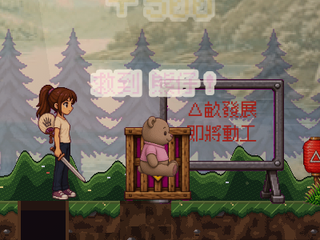
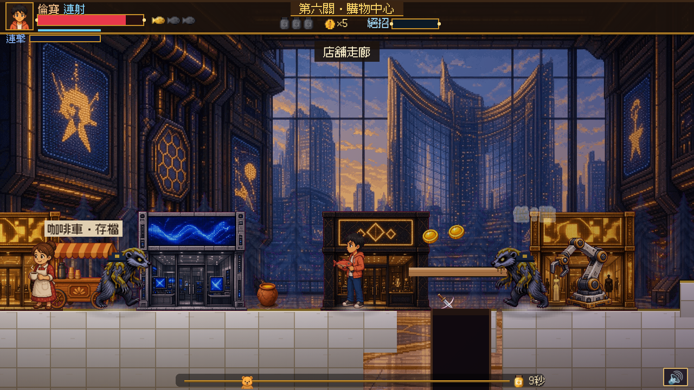

# 窿／地面辨識方案（提案，未確認）

## 問題及範圍

Alan 反映：玩嘅時候窿同地面顏色相近，會將地面誤認為窿、亦會將窿誤認為地面；唔止第4關。由關卡資料可知目前第1至6關都有窿；但**未逐關確認每個窿都出問題**。第7至10關未完成，之後亦應沿用已確認的辨識規格。

程式現時喺 `drawTerrainFeatures()` 將窿畫成深色矩形，加深褐色頂邊及兩條棕色直邊；地面以不同關卡貼圖顯示。呢啲係視覺圖層，碰撞則由獨立地形資料決定。實際難分嘅原因未逐處驗證，亦可能受背景、遮擋及手機縮放影響。

以下係**既有** QA 圖，唔係今次新增遊戲測試；圖只作場景例子，唔代表已證實每處都難分：

第一關森林窿（局部截圖）：

第六關商場窿及上方踏板（桌面截圖）：

## 選項

| | 做法 | 好處 | 留意 |
|---|---|---|---|
| A | 保留現有地面及窿形狀；令窿內部明顯較暗，再於窿兩側加連續、清晰嘅高對比邊線。各場景用協調色，唔只靠色相。 | 一眼見到開口同兩側邊界；可重用現有地形繪製。 | 夜景及暗幕下仍需檢查；邊線唔可遮住窿或營造假落腳位。 |
| B | 保留窿顏色，將安全地面嘅頂邊加連續亮邊，窿口中斷亮邊。 | 用「實線＝地面、中斷＝缺口」加形狀訊號；風格比較簡潔。 | 細窿同高低台要分清；避免斷線因場景裝飾而看似假窿。 |
| C | 喺窿兩側加關卡風格一致嘅細小裝飾，例如原創破損地板邊或石邊；唔改地形位置。 | 氣氛自然，森林／商場各有質感。 | 純裝飾可能被人物或特效遮住；需額外美術，較難保證細屏清楚。 |

**建議 A。** 先喺現有窿繪製加深度同兩側對比線，保持關卡美術色系。正式改動前要 Alan 確認；顏色、線粗同具體素材均未定，不可當作已批准。

## 驗收建議（待確認）

1. 以真實 `pits` 座標畫邊，唔改坑寬、碰撞、平台或敵人行為；可站立地面唔可以畫成窿。
2. 第1至6關，各抽正常、深色及有踏板嘅窿；自動化截圖覆蓋手機及桌面、兩側邊界，並記錄低亮度畫面及其他遮擋的限制。
3. 所有畫面嘅對比及清晰程度，日後可由 Alan 一併驗收；未實體測試唔當真機通過。

狀態：**只係方案，未更改遊戲程式或美術；等 Claude 審閱及 Alan 明確確認。**
